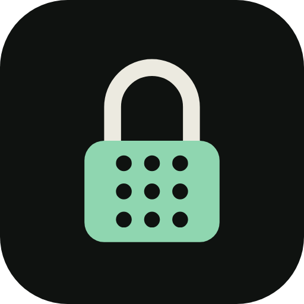

# Tumbler

**tumbler** - a Coco Experiments product (https://cocoexperiments.com). Simple, purposeful security.

Compose + Material 3 (dark) PIN lock screen with a shuffling 3x3 "digit group" keypad. The board shuffles when the lock opens and after a wrong tap, and stays fixed while you enter correct digits.

## Brand
The logo is a padlock whose body is the 3x3 keypad. `logo/gen_logo.py <repo root>` regenerates the launcher icon, the in-app logo and `docs/logo.svg` from one set of parameters (re-export `docs/logo.png` from the SVG if you change it).
All brand colours live in `ui/theme/Brand.kt` (plus the launcher icon in `res/drawable/ic_launcher_*.xml` and `res/values/colors.xml`). Replace them with official Coco Experiments values when available.

## One lock instead of two
Android does not let apps replace or disable the system lock. To unlock only once, set the system screen lock to None or Swipe (the Home screen of the app links to the setting). Trade-off: without a system lock, the Home button can still leave Tumbler.

## Build
Open in Android Studio (Ladybug or newer, JDK 17). Gradle 8.9 / AGP 8.7.3 / Kotlin 2.0.21.
`gradle testDebugUnitTest assembleDebug` (or `gradle wrapper` once to generate `gradlew`). Every push to `main` is built, given the next version (1.0.1, 1.0.2, ...) and published as a GitHub Release with the APK attached; download it on your phone and install it. Pull requests only get a test and build check. To start a new minor or major line, push a tag by hand such as `v1.1.0`.

## First run
1. Create and confirm a 4-digit PIN.
2. Grant: Display over other apps, Notifications, Full-screen alerts (Android 14+).
3. Turn on "Enable lock screen", then press the power button twice to test.

## Layout
- `domain/KeypadGenerator.kt` - board generator (every digit appears >= 2 times, 3 distinct digits per button)
- `domain/PinSession.kt` - step counter state machine + lockout policy
- `data/PinRepository.kt` - EncryptedSharedPreferences storage
- `service/` - foreground service (SCREEN_OFF/ON), launcher, boot receiver
- `LockScreenActivity.kt` - shows over the keyguard; `ui/` - Compose screens and components

## Known platform limits
- Android does not let third-party apps replace or unlock the system lock screen. This app sits above it;
  on success it calls requestDismissKeyguard() (the system PIN/biometric still applies if one is set).
- The Home/Recents buttons cannot be blocked without Device Owner / Lock Task mode.
- `androidx.security:security-crypto` is deprecated upstream but still works; USE_FULL_SCREEN_INTENT is restricted on Google Play to calling/alarm apps.
- Aggressive OEM battery managers may kill the service; exclude the app from battery optimisation.

## Staying locked (Home / Recents / swipe-away)
- The lock activity is excluded from Recents and lives in its own task.
- A persisted "armed" flag is set on screen-off and boot and cleared only by a correct PIN, so killing the app or leaving the lock screen does not unlock anything; the lock is brought back.
- Optional but recommended: enable **Tumbler lock guard** in Accessibility settings. It only watches window changes (no screen content) and re-shows the lock when Home, Recents or another app comes forward. Phone calls are allowed through. On Android 13+ a sideloaded APK needs *App info > menu > Allow restricted settings* first.
- If you are ever stuck behind the lock, reboot into Safe mode (third-party apps are disabled) and uninstall or clear the app.
- Not used on purpose: `noHistory` (it would destroy the lock on screen-off), `ACTION_CLOSE_SYSTEM_DIALOGS` (blocked for apps since Android 12) and Lock Task mode (needs Device Owner, otherwise it shows a pin prompt on every unlock).
